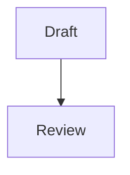

# Note Features

Mesa renders math, Mermaid diagrams and footnotes in Markdown notes. It also
has find and replace in a note, unlinked mentions, templates and hotkeys. All
of them work offline. Nothing in this list contacts a server.

## Math

Write inline math as `$E=mc^2$` and display math as `$$x^2$$` or as a block:

```markdown
$$
\int_0^1 x^2 \, dx
$$
```

An inline `$` must not be followed by a space, and the closing `$` must not be
preceded by a space or followed by a digit. Text such as "$5 and $10" therefore
stays text. Write `\$` for a literal dollar sign.

KaTeX typesets the math after the preview inserts it. KaTeX and its fonts load
only when a note has math. Untrusted TeX cannot add links, classes or remote
resources (`trust: false`). An invalid formula shows as an inline error.

## Mermaid diagrams

A fenced code block with the language `mermaid` renders as a diagram:

````markdown

````

Mermaid loads only when a note has a diagram. It runs with `securityLevel:
"strict"` and SVG text labels, and a diagram's `%%{init}%%` directive cannot
change security, CSS, label or theme settings. Mesa sanitizes the SVG before
it enters the page: no scripts, event handlers, links, images,
`foreignObject`, animation elements or external `url()` references. Diagram
styles keep only rules scoped to that diagram, and its class names get a
`mmd-` prefix, so a diagram cannot restyle Mesa or borrow its styles. A diagram
that cannot render keeps its source and shows the error below it. Paper and
light System use Mermaid's light palette; the other themes use the dark palette.
Rendered diagrams redraw when the theme switches palette.

## Footnotes

`Text.[^1]` with a definition `[^1]: Source.` renders a numbered reference and
a footnote list at the end of the note, with links back. Footnote links scroll
inside the same preview, so two open previews never jump into each other.

## Find and replace in a note

Press `Ctrl/Cmd+F` in the editor, or use **Find** in the editor toolbar or the
palette command "Find and replace in current note". The panel opens above the
note and supports match case, regular expressions, whole words, replace and
replace all. A replacement is an ordinary edit: it goes through undo history
and the normal verified save.

## Unlinked mentions

Below **Linked mentions**, the **Unlinked mentions** section lists other
Markdown notes that contain the current note's title or an alias as plain
text, including notes that already link to it elsewhere. The section stays
closed until you open it, and it scans indexed notes in short
slices so typing stays responsive. Matches are whole words and ignore case.
Mesa skips text that is already a link, a tag, a footnote reference, code, a
URL, HTML, math or frontmatter.

**Link** replaces that one occurrence with `[[Title]]`, or with
`[[Title|text]]` when the case differs. When the title resolves to another
note first, Mesa uses the note's path instead. Mesa refuses a link when the
name contains `#`, `|`, `^`, `[` or `]`, and refuses `[[Title|text]]` in a
table row, because the `|` would split the cell. The change uses the verified
text-save queue against the current text. If the text at that position has
changed, Mesa refuses the edit and asks you to refresh the list. A failed write
stays visible in the save-recovery UI.

## Templates

Put Markdown notes in the templates folder (Settings → **Templates folder**,
default `Templates`; subfolders count). The palette command **Insert
template…** lists them. Mesa fills `{{date}}` (YYYY-MM-DD), `{{time}}` (HH:MM)
and `{{title}}` (the open note's title) and inserts the result at the cursor of
the open note. The insert is an ordinary edit with undo and verified save. The
daily note still uses `daily.md` in the same folder.

## Hotkeys

Settings → **Hotkeys** assigns a shortcut to any command-palette command. Click
**Set**, press the keys, or press Escape to cancel. A shortcut needs
`Ctrl/Cmd` or `Alt` with a key, or a function key, so ordinary typing never
runs a command. One setting works on every platform: its `Mod` key is `Cmd` on
macOS and `Ctrl` on Windows and Linux. `Ctrl` on macOS and keys typed with
AltGr are never shortcuts, so terminal keys and characters such as `@` stay
free.

Mesa refuses shortcuts that it or the editor already uses (for example
`Ctrl/Cmd+P` with any other modifier, `Ctrl/Cmd+F`, `Ctrl/Cmd+Z`, `Ctrl/Cmd+D`,
`Shift+Tab`, and `Ctrl/Cmd` or `Alt` with arrow, Home, End, Backspace or
Delete keys) and shortcuts that another command has. A user shortcut takes precedence over the editor's own
keymap. The palette shows each assigned shortcut beside its command. Hotkeys
are stored in Mesa's settings, not in the vault.

## Code

| Feature | Code | Tests |
| --- | --- | --- |
| Math, footnotes, Mermaid fences | `src/lib/markdownParser.ts`, `markdownEnhance.ts`, `markdownMath.ts`, `markdownMermaid.ts` | `markdownMath.test.ts`, `markdownMermaid.test.ts`, `MarkdownView.noteFeatures.test.tsx` |
| Find and replace | `src/components/Editor.tsx`, `src/lib/editorCommands.ts` | `editorFindReplace.test.tsx` |
| Unlinked mentions | `src/lib/unlinkedMentions.ts`, `src/components/Backlinks.tsx`, store `linkUnlinkedMention` | `unlinkedMentions.test.ts`, `Backlinks.unlinked.test.tsx`, `store.noteFeatures.test.ts` |
| Templates | `src/lib/daily.ts` (`templatePaths`, `applyTemplate`), store `renderTemplate`, `CommandPalette.tsx` | `daily.test.ts`, `store.noteFeatures.test.ts`, `paletteHotkeys.test.tsx` |
| Hotkeys | `src/lib/hotkeys.ts`, `src/components/paletteCommands.ts`, `useCustomHotkeys.ts`, `HotkeySettings.tsx` | `hotkeys.test.ts`, `settings.test.ts`, `paletteHotkeys.test.tsx` |

## Limits

- Link, tag and task extraction does not know about math. A `[[link]]` written
  inside `$...$` still counts as a link in the graph and backlinks.
- Unlinked mentions skip notes whose text is not indexed yet and say how many.
